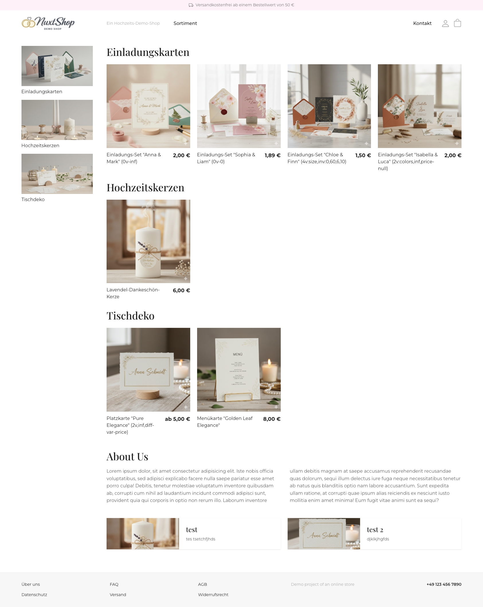
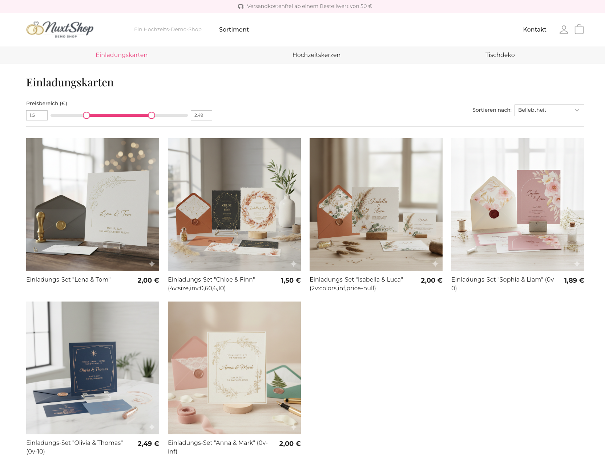
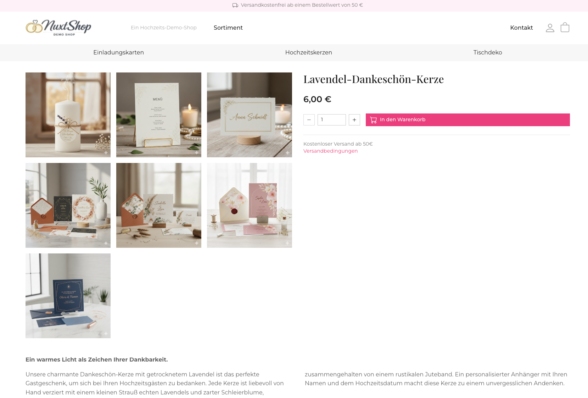
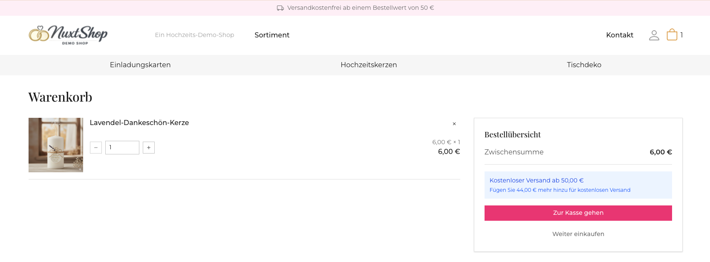
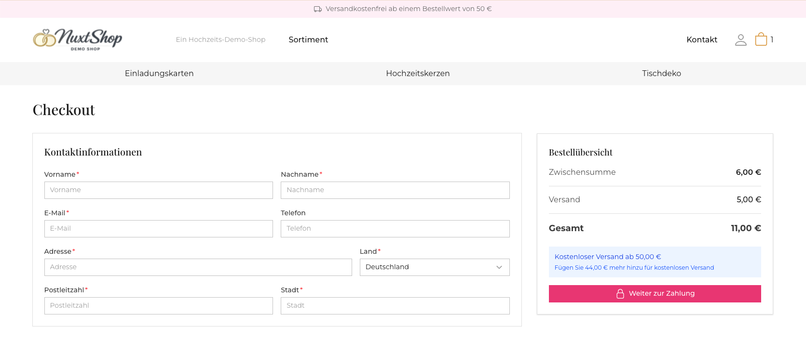
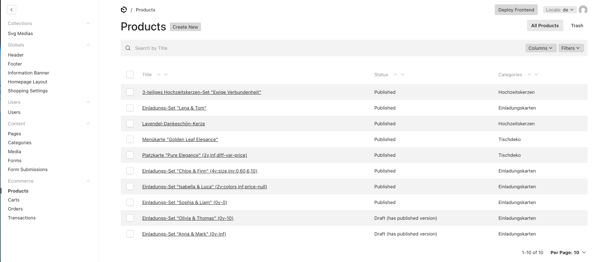
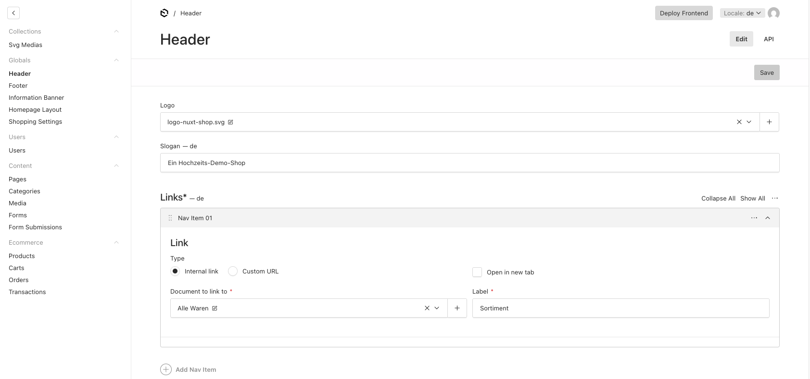

# Payload + Nuxt 3 E-commerce Demo

A modern, full-stack e-commerce demonstration built with **Payload CMS** (headless backend) and **Nuxt 3** (frontend).

🚀 **Live Demo:** [https://payload-vue-shop.vercel.app/](https://payload-vue-shop.vercel.app/)

### Frontend (Nuxt 4)






### Backend (Payload)



## Tech Stack

### Backend (`/payload`)
- **CMS:** Payload CMS (v3.0+)
- **Database:** PostgreSQL (Supabase)
- **API:** GraphQL & REST
- **Hosting:** Vercel (Serverless)

### Frontend (`/shop`)
- **Framework:** Nuxt 3 (Vue.js)
- **Styling:** Tailwind CSS + Nuxt UI
- **Data Fetching:** GraphQL
- **State Management:** Pinia

## Project Structure

This monorepo contains the following main directories:

- `payload/` - The backend CMS application. Manages products, categories, pages, and users.
- `shop/` - The frontend storefront application. Consumes data from Payload via GraphQL.
- *(Note: `storefront/` is a legacy version and should be ignored)*

## Getting Started

### Prerequisites
- Node.js (v20+)
- PostgreSQL database (e.g., Supabase)
- **Docker** and **Docker Compose** (recommended for local development)

### Local Development (Docker)
The easiest way to run both the frontend and backend locally with hot-reloading is using Docker Compose:

1. **Clone the repository:**
    ```bash
    git clone https://github.com/your-username/payload-vue-shop.git
    cd payload-vue-shop
    ```

2. **Configure Environment Variables:**
    - In the `payload` directory, copy `.env.example` to `.env` and fill in your `DATABASE_URI` and `PAYLOAD_SECRET`.
    - In the `shop` directory, copy `.env.example` to `.env`.

3. **Start the containers:**
    ```bash
    docker-compose up --build
    ```
    - The **Backend (Payload)** will be available at `http://localhost:3000`
    - The **Frontend (Nuxt)** will be available at `http://localhost:3001`

### Local Development (Manual / Without Docker)
If you prefer not to use Docker, you can run the applications manually:
1. Setup Backend: `cd payload && npm install && npm run dev`
2. Setup Frontend: `cd shop && npm install && npm run dev`

## Features

- **Dynamic Content:** Pages, products, and categories managed via Payload CMS.
- **Custom Shop Settings:** Global settings for category ordering and featured products.
- **Responsive Design:** Mobile-first approach using Tailwind CSS.
- **Modern UI:** Built with Nuxt UI components.
- **SEO Friendly:** Server-side rendering (SSR) with Nuxt.
- **Payment:** Stripe.

## Deployment

### Coolify (Recommended)
This project is fully configured for deployment via [Coolify](https://coolify.io/) using Multi-stage Dockerfiles.

1. Create two new Services/Applications in your Coolify dashboard.
2. **Backend (Payload)**: Set the Build Directory to `./payload`. Coolify will automatically build the `production` stage of the provided `Dockerfile`.
3. **Frontend (Nuxt)**: Set the Build Directory to `./shop`. Coolify will automatically build the `production` stage of the provided `Dockerfile`.
4. Ensure you configure all necessary Environment Variables in Coolify for both applications.

### Vercel
The project can also be deployed on **Vercel** as two separate projects (Backend & Frontend).
- Backend runs as a Next.js application.
- Frontend runs as a Nuxt application.
